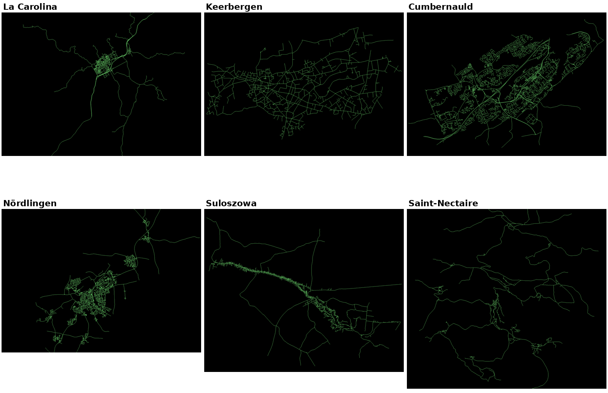
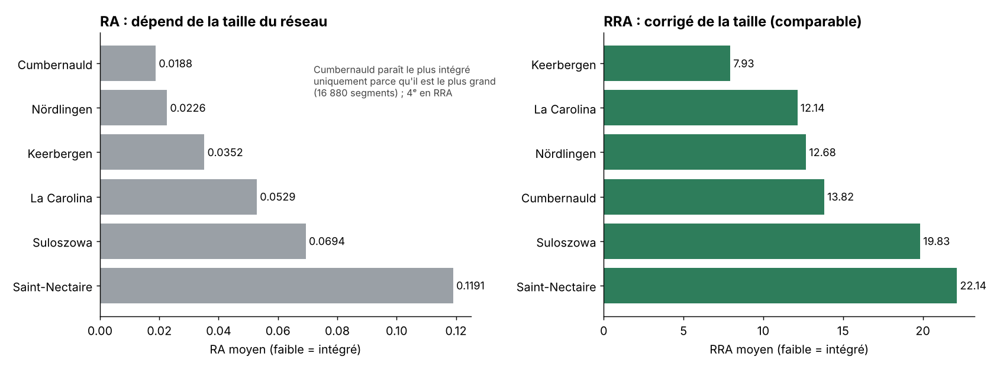
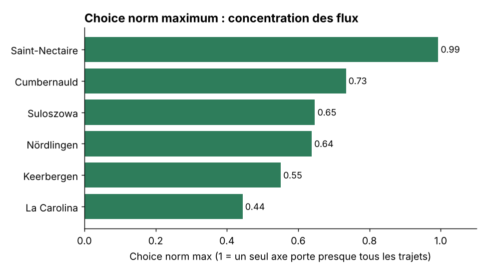

# Syntaxe spatiale : analyse comparative de six villes

> Comment la forme d'un réseau de rues détermine-t-elle son accessibilité ? Comparaison de six villes européennes avec les indices de la syntaxe spatiale.
> *Space syntax segment analysis (DepthmapX) of six towns: Mean Depth, RA, RRA, Integration HH, Choice, normalised Choice.*



**Master 2 Géomatique et modélisation spatiale (GMS)**, Aix-Marseille Université · 2026-2027
Cours *Modélisation de l'espace urbain par la syntaxe spatiale*, Thomas Gloaguen · **Projet individuel** · Présentation en anglais

---

## Question

Six villes aux formes très différentes (grille, maillage pavillonnaire, ville nouvelle hiérarchisée, noyau concentrique, village-rue, hameaux dispersés) : lesquelles sont les plus **intégrées**, et où se **concentrent les flux** de passage ?

## Données et méthode

- Cartes de segments analysées sous **DepthmapX**, de **3 405 à 16 880 segments** selon la ville
- Indices lus dans les tables attributaires, en moyenne sur tous les segments de chaque carte

| Indice | Ce qu'il mesure | Comparable entre villes ? |
|---|---|---|
| **Mean Depth** | Nombre moyen de pas d'un segment vers tous les autres | ❌ dépend de la taille |
| **RA** | Mean Depth ramené entre 0 et 1 : `2(MD − 1) / (n − 2)` | ❌ dépend encore de la taille |
| **RRA** | RA divisé par une valeur de référence Dₙ pour un système de même taille | ✅ **l'indice de comparaison** (faible = intégré) |
| **Integration HH** | `1 / RRA` | ✅ (élevé = intégré) |
| **Choice** | Nombre de plus courts chemins passant par un segment (flux de transit) | ❌ croît avec la taille |
| **Choice norm** | Choice normalisé (on lit son maximum et sa dispersion) | ✅ |

## Résultats

| Ville | Segments | Mean Depth | RA | **RRA** | Int. HH | **Choice norm max** |
|---|---:|---:|---:|---:|---:|---:|
| Keerbergen | 4 271 | 76,2 | 0,035 | **7,93** | 0,133 | 0,55 |
| La Carolina | 4 368 | 116,4 | 0,053 | **12,14** | 0,096 | 0,44 |
| Nördlingen | 12 384 | 140,6 | 0,023 | **12,68** | 0,083 | 0,64 |
| Cumbernauld | 16 880 | 159,3 | 0,019 | **13,82** | 0,076 | 0,73 |
| Suloszowa | 5 650 | 196,9 | 0,069 | **19,83** | 0,053 | 0,65 |
| Saint-Nectaire | 3 405 | 203,6 | 0,119 | **22,14** | 0,047 | 0,99 |

**Classement par intégration (RRA)** : Keerbergen > La Carolina > Nördlingen > Cumbernauld > Suloszowa > Saint-Nectaire



- **La taille fausse le RA.** Avec le RA, Cumbernauld paraît la plus intégrée, seulement parce que c'est la plus grande ville. Avec le RRA, elle tombe au 4ᵉ rang.
- **La forme fait l'intégration.** Les réseaux maillés (Keerbergen, la grille de La Carolina, le noyau de Nördlingen) sont peu profonds. Les réseaux hiérarchisés (Cumbernauld), linéaires (Suloszowa) ou dispersés (Saint-Nectaire) sont profonds.
- **Choice révèle la structure.** Une grille répartit les flux sur de nombreux itinéraires (La Carolina : 0,44). Un réseau en arbre les concentre : à Saint-Nectaire, un seul axe porte presque tous les plus courts chemins (0,99).



| Ville | Lecture morphologique |
|---|---|
| **Keerbergen** | Maillage pavillonnaire continu et homogène : la ville la moins profonde |
| **La Carolina** | Grille orthogonale compacte et longues « tentacules » rurales : le plus fort contraste centre-périphérie |
| **Nördlingen** | Noyau concentrique et villages satellites : l'anneau et les radiales forment des goulots |
| **Cumbernauld** | Ville nouvelle : voie rapide en épine dorsale, quartiers en boucles et impasses, flux très inégaux |
| **Suloszowa** | Village-rue : un axe principal et des centaines d'accès en impasse |
| **Saint-Nectaire** | Petits hameaux reliés par de longues routes : un réseau en arbre avec un lien dominant |

## Limites

Les résultats dépendent aussi de l'**emprise de la carte** (un cadrage serré réduit la profondeur, c'est le cas de Keerbergen) et du **rayon d'analyse**.

## Intérêt pour l'urbanisme

Ces indices aident à repérer les axes structurants et les quartiers enclavés, et à anticiper l'effet d'un nouveau maillage (percée, franchissement) sur l'accessibilité d'un projet urbain.

## Outils

`DepthmapX` · analyse de segments · `Python` (graphiques)

## Contenu du dépôt

```
├── figures/        réseaux des 6 villes, RA vs RRA, Choice norm
└── presentation/   support de présentation (PDF, anglais)
```

---

**Auteur :** Ezechiel Agbewanou SOUKOU, géomaticien-urbaniste · [LinkedIn](https://www.linkedin.com/in/ezechiel-soukou) · [Autres projets](https://github.com/ezekielofficiel7-spec)
